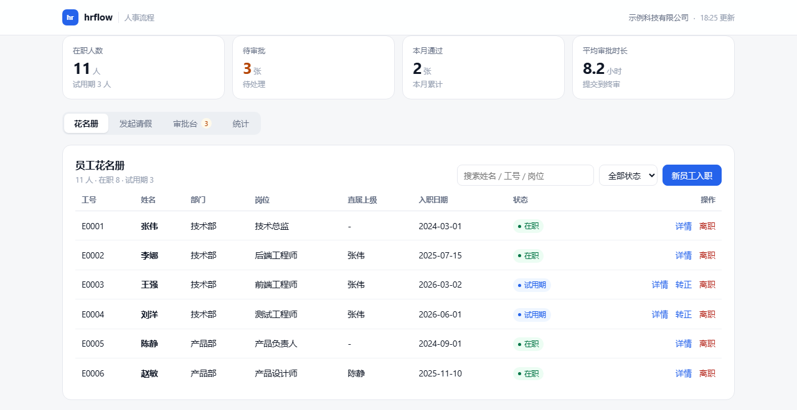

# 人事流程 mini 版（hrflow）

[](https://github.com/dongshu710/hrflow/actions/workflows/ci.yml)


一个**能跑起来、能讲清楚**的人事流程小项目：员工信息管理（含入转调离）+ 请假审批（含多级审批与假期额度账本）+ AI 预审 + 报表导出。

定位不是"造一个 HR 系统"，而是回答一个问题：**基础人事流程里那些琐碎、易错、靠人记的环节，能不能用工具固定下来？**
代码用 Python 标准库 + SQLite，**零第三方依赖**，克隆下来直接能跑。



```
python scripts/seed.py         # 1. 灌入演示数据（11 名员工 / 7 张请假单）
python scripts/run_server.py   # 2. 启动，浏览器打开 http://127.0.0.1:8770
python scripts/demo.py         # 3. 终端跑一遍全链路演示（可选）
python tests/test_hrflow.py    # 4. 跑单元测试（20 个用例）
```

---

## 一、先说结论：这个项目的思路

1. **先调研再动手。** 成熟开源项目踩过的坑不必重踩，见 [`research/开源人事项目调研.md`](research/开源人事项目调研.md)——
   重点拆了 frappe/hrms（8.9k star）、horilla（1.5k star）、OrangeHRM（1.2k star）三个，
   提炼出 12 条可借鉴点，也明确了 5 类"不照搬"的东西。
2. **照搬"切分方式"，不照搬"体量"。** 抄的是它们的模块划分逻辑与状态机思想，
   不是它们的低代码表单引擎、多租户和微服务。
3. **流程要能度量。** 做了"平均审批时长""部门请假统计"这类指标——
   说"优化了流程"是空的，说"审批时长从 X 小时降到 Y 小时"才是 HR 听得懂的话。

---

## 二、目录结构

```
人事流程/
├── hrflow/                     # 核心代码，四层结构
│   ├── domain/                 # 领域层：实体 + 状态机 + 异常（不依赖任何基础设施）
│   │   ├── models.py           #   员工 / 部门 / 请假单 / 假别 / 额度 / 账本 / 审批留痕
│   │   ├── workflow.py         #   配置驱动的通用状态机 + 审批链路由规则
│   │   └── errors.py           #   带 code 的业务异常，API 层直接映射响应
│   ├── repository/             # 数据层：只有 SQL，没有业务规则
│   │   ├── schema.sql          #   建表（幂等）
│   │   ├── db.py               #   连接、初始化、事务上下文
│   │   ├── employee_repo.py
│   │   └── leave_repo.py
│   ├── services/               # 服务层：业务用例（规则与流程编排都在这）
│   │   ├── employee_service.py #   入职建档、转正、调动、离职、假期折算
│   │   ├── leave_service.py     #   申请校验、审批推进、额度落账
│   │   ├── smart_review.py      #   AI 预审（规则引擎 + 可选大模型）
│   │   └── report_service.py    #   看板指标、统计、CSV 导出
│   ├── api/server.py            # 接口层：REST + 静态页面托管（标准库实现）
│   └── config.py                # 节假日、阈值等可配项
├── web/                         # 前端：index.html + app.js + style.css（原生 JS）
├── scripts/                     # seed.py（演示数据）/ run_server.py / demo.py
├── tests/test_hrflow.py         # 20 个单元测试
├── research/开源人事项目调研.md   # 调研报告
└── data/                        # 运行产物：hrflow.db、导出的 CSV
```

**数据流**（以请假为例）：

```
web/app.js ──fetch──> api/server.py ──> services/leave_service.py ──┬─> domain/workflow.py（能不能流转）
                                                                    ├─> domain/models.py（实体）
                                                                    └─> repository/leave_repo.py（落库）
```

依赖方向是**单向**的：api → services → domain ← repository。领域层谁都不依赖，
所以"请假能不能批"这件事可以脱离数据库和网页单独测试。

---

## 三、核心设计决策（以及为什么这么定）

### 1. 审批流是一个"配置"，不是一堆 if

`domain/workflow.py` 里定义了一个通用状态机：状态 + 转换 + 允许角色 + 前置校验。
请假只是它的一个实例，将来加"加班申请""报销"复用同一套引擎。

```
draft ──submit──> pending ──approve(还有下一级)──> pending
  │                  │
  │                  ├──approve(最后一级)──> approved ──同时写额度账本
  │                  ├──reject──────────────> rejected
  └──cancel──> cancelled <──cancel──┘
```

终态（approved / rejected / cancelled）不可再流转，越权操作直接拒绝并给出可读的原因。

### 2. 审批链按"角色 + 条件"路由，不写死人

```python
ROUTING_RULES = [
    {"max_days": 2,   "chain": ["manager"]},                      # 2 天以内：主管
    {"max_days": 5,   "chain": ["manager", "hr"]},                # 3–5 天：主管 + HR
    {"max_days": 999, "chain": ["manager", "hr", "director"]},    # 5 天以上：加总监
]
# 年假（涉及额度）、病假（涉及证明）、事假（涉及无薪折算）一律加 HR 复核
```

员工换主管、组织调整，都不需要改代码。

### 3. 假期余额是"账本算出来的"，不是一个字段

- `leave_allocations`：额度发放（年度发放 / 手工补 / 结转，带来源标记）
- `leave_ledger`：消耗流水，**每笔都指向具体请假单**
- 余额 = 发放合计 − 消耗合计

好处：余额对不上时能一查到底是谁、哪张单、扣了多少。
只在"最终通过"时扣账，中间态不占用额度，所以撤回不需要回冲逻辑。

### 4. 校验集中在一个函数里，规则可枚举

`leave_service._validate_submit()` 串起 8 条规则，每条抛出的异常都带 `code`
（`insufficient_balance` / `date_overlap` / `back_dated` / `attachment_required` …），
前端可以直接把 code 翻译成用户话术：

| 规则 | 说明 |
| --- | --- |
| 在职校验 | 非在职员工不能请假 |
| 单次上限 | 假别表配置，如事假单次 ≤ 5 天 |
| 额度校验 | 余额不足直接拦截（事假等无额度假别跳过） |
| 日期重叠 | 同一人同一时段不能有两张未作废单据 |
| 追溯申请 | 开始日期早于今天 → 要求走补假流程 |
| 提前天数 | 年假需提前 3 天，事假 1 天 |
| 证明材料 | 病假必须上传医疗证明 |
| 工作日计算 | 自动剔除周末与法定节假日 |

### 5. AI 预审：规则引擎为主，大模型只做"翻译"

`smart_review.py` 先跑确定性规则（额度、团队同期冲突、连休、缺材料、近期频次、跨月核算），
产出结构化风险项；如果配置了 `LLM_API_KEY` / `LLM_BASE_URL` / `LLM_MODEL`，再叠一段给审批人看的中文建议。

接口只依赖 OpenAI 兼容的 `chat/completions` 协议，接哪家服务由环境变量决定，代码里不含厂商与密钥：

```bash
export LLM_API_KEY=...            # 不配置即关闭该能力
export LLM_BASE_URL=https://<host>/v1
export LLM_MODEL=<model-name>
```

**没有 Key、断网、超时，都静默降级为纯规则输出，功能不受影响。**
大模型不参与"能不能批"的判断——合规上，AI 可以给建议，不应该替人做决定。

### 6. 档案变动留"事件表"

入职 / 转正 / 调动 / 晋升 / 离职都写 `employee_events`，带变动前后值与生效日期。
HR 最怕"这个人什么时候调的岗、谁批的"，事件表就是答案。
顺带做了两个真实规则：**新员工年假按剩余自然月折算**、**有未结单据不能办离职**。

---

## 四、已实现 / 未实现（边界写清楚）

**已实现**：员工建档与花名册、入转调离、假期额度发放与账本、请假申请 8 条校验、
多级审批与留痕、撤回/驳回、AI 预审、看板指标、部门与月度统计、CSV 导出、Web 界面、单元测试。

**有意不做**（对应调研报告第六节）：低代码表单引擎、多租户、细粒度权限矩阵、
薪酬/税务/社保、消息队列与异步任务、前端工程化。

---

## 五、界面

**信息层级**：顶栏（组织 + 更新时间）→ 指标条（4 项，待审批高亮为琥珀色）→ 分段页签 → 单一面板。
一屏只突出一个重点，其余信息降为灰色辅助。

四个页签：**花名册**（搜索 / 建档 / 转正 / 离职 / 详情含余额与异动记录）、
**发起请假**（实时预审 + 提交）、**审批台**（切换角色看不同待办、AI 预审、审批轨迹、同意/驳回/撤回）、
**统计与导出**。页签支持 `#employees` / `#apply` / `#approve` / `#stats` 直达。

**统一的部分**（`web/style.css` 顶部的设计变量）：

| 项目 | 规则 |
| --- | --- |
| 间距 | 4px 刻度：4 / 8 / 12 / 16 / 20 / 24 |
| 字号 | 26（指标）/ 16（面板标题）/ 14（正文）/ 13（表格）/ 12（辅助）/ 11.5（表头、状态） |
| 颜色 | 1 个主色（#2563eb）+ 3 个语义色（通过/待处理/驳回）+ 4 级灰阶 |
| 圆角 | 8（控件）/ 10（卡片组）/ 14（面板、弹窗） |
| 控件高度 | 输入框、按钮统一 34–36px，对齐不跳动 |

**几处刻意的取舍**：

1. **详情不再"插在页面里"**：员工详情、单据详情、新建表单共用同一个弹窗，
   桌面居中、手机变成底部抽屉，打开时不会把下面的列表顶走。
2. **表格在窄屏变卡片流**：≤820px 时 9 列表格改成卡片，字段用 `data-label` 自动带标签，
   列数自适应（手机 2 列、平板 4 列），不会出现横向滚动条，也不会出现落单字段。
3. **纯数字小表保留表格形态**：统计页只有 4 列，改成卡片反而占三倍高度，所以专门保留了紧凑表格。
4. **状态用"圆点 + 文字"**：整块色底会把注意力拉平，小圆点足够区分且不抢标题。
5. **视觉重点只有一个**：待审批数用琥珀色（唯一强调色），其余指标保持中性。

演示数据里刻意准备了 7 张不同状态的单据：一级审批中、二级审批中（主管已过待 HR）、
三级审批中（>5 天加总监）、已通过、已驳回、已撤回。

---

## 六、已知边界与扩展方向

**这个项目刻意不做的**（成熟系统之所以复杂，是因为要适配成百上千家企业）：

| 不做 | 原因 |
| --- | --- |
| 权限体系 / 多租户 | 属于平台能力，不是「一条人事流程」本身 |
| 薪酬、社保、个税 | 强地区政策依赖，做浅了不如不做 |
| 消息队列 / 异步任务 | 单机 SQLite 场景下是过度设计 |
| 低代码表单引擎 | 需要先造一套框架，收益不在「把流程讲清楚」 |

**如果继续往下做，我会按这个顺序**：

1. **接入统一认证**（OAuth / LDAP），把「当前角色」从下拉框换成登录态，
   审批权限才能真正落地；
2. **假期规则可配置化**：把 `config.HOLIDAYS` 换成节假日表，把折算规则从代码搬到配置；
3. **销假与调休冲抵**：目前「已通过」不可撤回，实际业务需要一条反向单据；
4. **审批超时提醒**：`approval_tasks` 已经有完整时间戳，加一个定时任务即可算出超时单；
5. **接口层换成 FastAPI**：`services/` 一行不用改，只是把路由与参数校验交给成熟框架。

---

## 七、许可

MIT，见 [LICENSE](LICENSE)。
